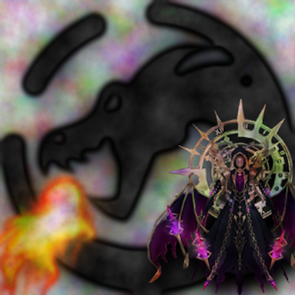
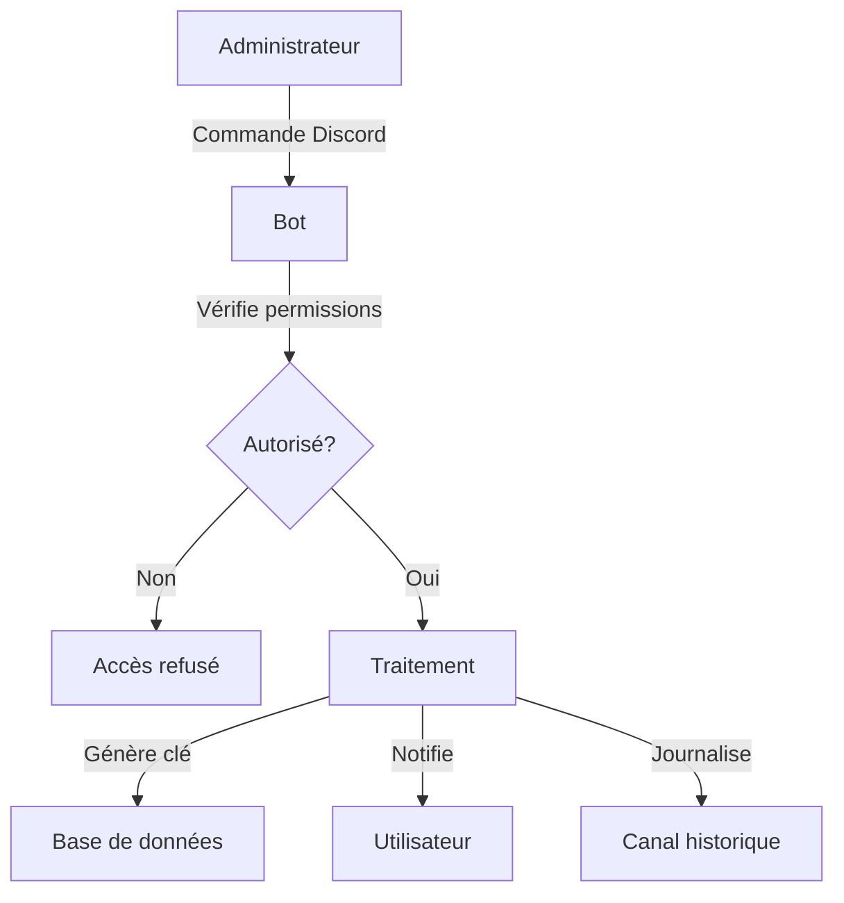

<div align="center">

# OptiGF - Documentation technique 🚀

</div>

<div align="center">

*Une pack complet (Site / Application / Bot et serveur Discord) pour la gestion des injections Grand Fantasia*

*Communauté francophone uniquement...*




[](https://discord.gg/58j4JnYFdz)
[]()
[]()

___

## 📑 Table des matières

[Caractéristiques](#caractéristiques-) • [Structure](#structure-) • [Bot Discord](#bot-discord-) • [Sécurité](#sécurité-) • [API](#api-) • [URL](https://optigf.eu/)

</div>

___

<div align="center">

## Caractéristiques 📑

</div>

| Fonctionnalité | Description |
|----------------|-------------|
| 📊 Site Web | Guides, Config comptes, Téléchargement Injection |
| 🔒 Sécurité | Clés uniques renouvellables, Managers sur le site |
| 🔄 API EndPoint | Interface programmatique sécurisée |
| ♻️ TrapFantasia | Application se connectant à l'API (non disponible sur le repo) |
| 🤖 Bot Discord | Gestion utilisateurs et des clés depuis Discord |

___

<div align="center">

## Structure 📑

</div>

```plaintext
optigf/
  │
  ├── www/                               # Interface Web 🌐
  │   ├── api/v1/connect.php                 # API REST
  │   ├── assets/ ...                        # Ressources ...
  │   ├── gf/                                # Logique GF
  │   └── managers/                          # Gestionnaires
  │
  │
  ├── discord-bot/                       # Bot Discord 🤖
  │   ├── src/ bot.js                        # Code principal (commandes, ...)
  │   ├── Dockerfile                         # Dockerfile
  │   └── package.json                       # Importation dépendances
  │
  │
  ├── mariadb-config/                    # MARIADB Config ⚙️
  │     └── conf.d/ timezone.cnf             # Europe/Paris
  │           └── ...                        # Ressources image ...
  │
  │
  ├── mariadb-data/                      # MARIADB bdd ♻️
  │     └── ...                              # datas ...
  │
  │                                      
  ├── php-config/                        # PHP ⚙️
  │   ├── docker-php-ext-mysqli.ini          # Extension MySQL i
  │   ├── docker-php-ext-pdo_mysql.ini       # Extension MySQL PDO
  │   ├── env.php                            # Variables env PHP
  │   ├── env.php.example                    # Exemple Variables env PHP
  │   ├── GF_TG_UI_Vx.y.zip                  # ZIP Injection avec UI Trap
  │   └── GF_TG_Vx.y.zip                     # ZIP Injection Trap
  │
  ├── phpmyadmin-config/                 # PHPMYADMIN ⚙️
  │   ├── themes/ ...                        # Thèmes
  │   ├── config.secret.inc.php              # Secret Blowfish
  │   ├── config.secret.inc.php.example      # Exemple Secret Blowfish 
  │   ├── config.inc.php                     # Réglages PMA par défault
  │   └── config.user.inc.php                # Réglages PMA modifications
  │
  │
  │                                      # DOCKER ⚙️
  ├── compose.override.yml                   # Fichier Docker-Compose
  ├── Dockerfile                             # Dockerfile
  ├── optigf.env                             # Fichier Docker-Compose
  ├── optigf.yml                             # Fichier Docker-Compose
  │
  │                                      # GIT ⚙️
  ├── .gitignore                             # Git Ignore
  └── README.md                              # Read Me
```

___

<div align="center">

## Bot Discord 📑

</div>

### 🎯 Commandes administrateur


```v
/help           // Affiche la liste des commandes disponibles

/list-users     // Liste tous les utilisateurs enregistrés et leur statut UI

/test-notify    // Envoie la clé actuelle à un utilisateur spécifique
                // Paramètre: user:<nom_utilisateur>   

/update-key-all // Renouvelle toutes les clés et notifie les utilisateurs

/send-mp        // Envoie un message privé à un utilisateur spécifique
                // Paramètres: user:<nom_utilisateur> message:<texte>

/send-channel   // Envoie un message dans le salon actuel
                // Paramètre: message:<texte>

/update-user    // Gestion complète des utilisateurs (ajout/suppression/modification)
            // * ajouter: old-user:none new-user:<nom> ui-status:<true/false>
            // * supprimer: old-user:<nom> new-user:none
            // * modifier: old-user:<nom> new-user:<nouveau_nom> ui-status:<true/false>
```

### 🔒 Sécurité et contrôle d'accès
- Vérification des rôles administrateur pour chaque commande
- Limitation des commandes à un salon spécifique
- Journalisation complète des actions dans un canal dédié
- Messages éphémères pour les réponses sensibles

### 🔄 Fonctionnement de la gestion des clés



### ♻️ Renouvellement des clés

- Génération de clés uniques et sécurisées
- Mise à jour dans la base de données
- Notification automatique aux utilisateurs par message privé
- Journalisation des succès et échecs

### 👑 Gestion des accès premium (UI)

- Attribution ou révocation des accès UI via la commande update-user
- Notification automatique aux utilisateurs concernés
- Système de traçabilité des modifications d'accès
___

<div align="center">

## Sécurité 📑

</div>

### 🛡️ Mesures de protection

> ⚠️ **Important** : Les clés sont générées de manière cryptographiquement sûre.

- Points clés 🔐
    | **Authentification** | **Données** |
    | :----: | :----: |
    | Clés uniques | Chiffrement |
    | Historique | Validation |
    | Rate limiting | Logs |


- Exemple de validation 📋

```php
if (!preg_match('/^[a-zA-Z0-9_.-]{2,32}$/', $key)) {
    throw new SecurityException('Format de clé invalide');
}
```
___

<div align="center">

## API 📑

</div>

### Point d'entrée 🔐

| Endpoint | Méthode | Description | Authentification |
|:----------:|:---------:|:-------------:|:------------------:|
| `/api/v1/connect` | POST | Authentification | Clé requise |

> L'API suit une architecture REST sécurisée.

### Requête 📋

```http
POST /api/v1/connect HTTP/1.1
Content-Type: application/json

{
    "discord": "votre_username",
    "password": "votre_mot_de_passe",
    "account_key": "votre_clé"
}
```

### Réponses 📋

```http
POST /api/v1/connect HTTP/1.1
Content-Type: application/json

{
    "user_id": "votre_id_bdd",
    "discord": "votre_username",
    "token": "votre_token_de_connexion"
}
```
| Code | Signification |
|------|---------------|
| `200` | Succès |
| `401` | Non autorisé |
| `429` | Trop de requêtes |
___

Enjoy !

<div align="center">

## https://optigf.eu/

</div>